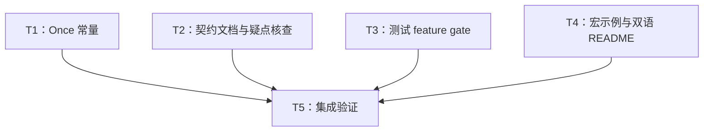

# rs-function 本轮评审改进实施计划

> **面向智能体执行者：** 使用 executing-plans 逐项实施并跟踪复选框；如果下一阶段采用并行执行，则按本计划写入集合使用 subagent-driven-development。无需重新选择采纳范围或等待设计审批。

**目标：** 落实 RF-01～RF-07，并先核查 RF-V01，只修复核查确认的问题。

**架构：** 保持现有语义 trait、所有权包装器和公开路径。三个 Once 常量在类型本地移交所有权；既有行为测试按真实 feature 依赖启用；文档修正以当前 API 事实为准。

**技术栈：** Rust 2024、固定 Rust `1.94.0`、Cargo、现有声明宏及测试/CI 基础设施。

**项目目录：** `/data/working/qubit/rust-common/rs-function`。

**设计依据：** [设计文档](design-20261030T094813112Z-5b206b6f.md)。

**文件位置约定：** 用户指定两份文档直接写入项目 `doc`，覆盖技能默认临时目录约定。本方案没有临时工作区；实施过程中不创建或打开新的 Paseo workspace。

## 1. 采纳范围与全局约束

| 评审条目 | 采纳内容 | 任务 |
| --- | --- | --- |
| RF-01 | 三个 Once constant 移交所有权，补回归与迁移说明 | T1、T4、T5 |
| RF-02 | 条件中间对象的调用流程说明 | T2、T5 |
| RF-03 | 当前 feature / receiver / 借用 / 内部可变性契约 | T2、T5 |
| RF-04 | 有边界的包装层性能成本说明 | T2、T5 |
| RF-05 | 主行为测试 feature gate 下移 | T3、T5 |
| RF-06 | 移除替身宏示例，验证真实格式化 | T4、T5 |
| RF-07 | 双语 README 的完整场景 | T4、T5 |
| RF-V01 | 先核查仅 stateful 的 rustdoc；确认后修复 | T2、T5 |

明确搁置或拒绝：无。RF-V01 的采纳不构成缺陷确认。

持续约束与设计一致：

1. 在用户当前 Paseo workspace 中处理目标项目及相关下游，不创建或打开新的 Paseo workspace。
2. 只修改与当前任务直接相关的内容，不顺手重构、格式化或清理。
3. CI 只负责验证当前 crate 自身；不得加入或保留 downstream all-features 测试。
4. 优先采用满足本轮目标的最小改动。确有必要的兼容性变化须说明原因、受影响调用方和迁移方式，不为统一风格或潜在扩展扩大重构范围。

执行开始时读取用户 AGENTS 中按修改类型触发的规则，确认 HEAD 和已有改动。不要覆盖用户或并发任务的变更。提交、推送等交付操作按下一阶段实施命令的明确授权决定，不把方案生成阶段的边界写成实施禁令。本计划不要求升级依赖、增加公开 family、发布或修改版本号。

## 2. 调度图

T1～T4 没有相互依赖，写入集合不相交，为同一可并行批次 A；T5 在四项完成后集成。并行可由执行环境和已授权技能调度，串行执行也保持同一依赖关系，不需要用户重新选择。

所有 Cargo 命令属于资源组 `rs-function-cargo`：共用仓库 target/编译契约缓存时串行执行，不让多个任务争用同一重型检查。可并行阅读与编辑；不要为并行而改造缓存或创建新 Paseo workspace。表中“解锁产物”指已完成并经本地验证的工作树内容，不以提交为前提。

| 任务 | 前置任务 | 最小解锁产物 | 写入集合 | 本地验证 | 集成验证归属 | 审查时机 |
| --- | --- | --- | --- | --- | --- | --- |
| T1：Once 常量 | 无，批次 A | 三个本地 constant 与聚焦回归 | 三个 Once 类型文件、常量宏的适用范围注释、`tests/once_constant_move_tests.rs` | `cargo test --locked --no-default-features --features once --test once_constant_move_tests` | T5 | 立即审查公开行为变化 |
| T2：契约文档与疑点核查 | 无，批次 A | 指定误述已修正；RF-V01 有诊断结论 | 第 4 节列出的 Rustdoc 文件；确认 RF-V01 时才修改 `.infra/ci/cargo-matrix.json` | RF-V01 修改前的严格 stateful rustdoc；其他内容人工核对签名 | T5 | 立即审查契约和条件修复 |
| T3：测试 gate | 无，批次 A | baseline/可选配置能发现对应现有测试，full 不丢测试 | `Cargo.toml` 的 integration_tests 声明、`tests/**/mod.rs` 的 gate、`tests/relaxed_bounds_tests.rs` 的组合 gate；不写 T1 回归文件 | 修改前后 full 发现清单；baseline/rc/once/stateful 的集成目标发现与代表性测试 | T5 | 立即审查 cfg 边界 |
| T4：宏示例与双语 README | 无，批次 A | 真实示例与同一双语场景、RF-01 迁移说明 | 两个 Consumer 格式化宏的文档、`README.md`、`README.zh_CN.md` | 示例与已读 API/格式实现逐项比对；相对链接检查 | T5 | 批量审查双语事实和示例 |
| T5：集成验证 | T1、T2、T3、T4 | 全部任务的最终工作树内容和聚焦证据 | 前述文件中由本轮引入的必要修正；在本计划追加验收记录 | diff 范围与任务覆盖核对 | 本任务统一负责矩阵、Clippy、文档、README、CI | 立即审查最终结果 |

## 3. 任务拓扑依赖图



## 4. T1：实现三个 Once 常量的所有权转移

**生产文件：**

- `src/transformers/transformer_once/box_transformer_once.rs`
- `src/transformers/bi_transformer_once/box_bi_transformer_once.rs`
- `src/suppliers/supplier_once/box_supplier_once.rs`
- `src/transformers/macros/transformer_constant_method.rs`：仅更新两个通用分支注释，移除支持 Once 的过时表述，保持重复型宏行为。

**测试：** `tests/once_constant_move_tests.rs`。沿用文件级 `cfg(once)` 和现有 `Resource` / `CloneTracked` helper，新增 import 每条只导入一个对象。

**输出接口：** 三个方法名和参数不变，分别为 `constant(value: R) -> Self where R: 'static`、`constant(value: T) -> Self where T: 'static`，见设计第 5 节。T4 依据该契约写迁移说明，T5 验证最终实现。

- [ ] 增加以下不可克隆返回值回归，并补充所用公共符号的独立 import：

```rust
#[test]
fn test_transformer_and_supplier_once_constants_move_non_clone_values() {
    let unary = BoxTransformerOnce::<i32, Resource>::constant(Resource("unary".into()));
    assert_eq!(unary.apply(7).0, "unary");

    let binary = BoxBiTransformerOnce::<i32, bool, Resource>::constant(Resource("binary".into()));
    assert_eq!(binary.apply(7, false).0, "binary");

    let supplier = BoxSupplierOnce::constant(Resource("supplier".into()));
    assert_eq!(supplier.get().0, "supplier");
}
```

- [ ] 增加零克隆及重复型对照回归，复用既有 `CloneTracked`：

```rust
#[test]
fn test_once_constants_do_not_clone_and_reusable_constants_still_clone() {
    let clones = Rc::new(Cell::new(0));
    let unary = BoxTransformerOnce::<i32, CloneTracked>::constant(CloneTracked {
        clones: Rc::clone(&clones),
    });
    let binary = BoxBiTransformerOnce::<i32, bool, CloneTracked>::constant(CloneTracked {
        clones: Rc::clone(&clones),
    });
    let supplier = BoxSupplierOnce::constant(CloneTracked {
        clones: Rc::clone(&clones),
    });
    let _ = unary.apply(0);
    let _ = binary.apply(0, false);
    let _ = supplier.get();
    assert_eq!(clones.get(), 0);

    let repeated = BoxTransformer::<i32, CloneTracked>::constant(CloneTracked {
        clones: Rc::clone(&clones),
    });
    let _ = repeated.apply(0);
    let _ = repeated.apply(1);
    assert_eq!(clones.get(), 2);

    let repeated_binary = BoxBiTransformer::<i32, bool, CloneTracked>::constant(CloneTracked {
        clones: Rc::clone(&clones),
    });
    let _ = repeated_binary.apply(0, false);
    let _ = repeated_binary.apply(1, true);
    assert_eq!(clones.get(), 4);

    let repeated_supplier = BoxSupplier::constant(CloneTracked {
        clones: Rc::clone(&clones),
    });
    let _ = repeated_supplier.get();
    let _ = repeated_supplier.get();
    assert_eq!(clones.get(), 6);
}
```

- [ ] 运行本地聚焦命令，确认当前因 `Resource: Clone` 未满足而编译失败。依赖下载/工具链错误不算预期失败。记录诊断后实施；不更改 `Resource` 使其可克隆。
- [ ] 在两个 TransformerOnce inherent impl 中增加设计第 5 节的专用方法，移除该类型原常量宏调用和未使用 import。保留构造、组合、trait impl 和 metadata 不变。
- [ ] 在 `BoxSupplierOnce` 将 common 宏调用替换为现有基础宏，保留其他方法，再增加设计中的本地 `constant`：

```rust
impl_supplier_new_methods!(BoxSupplierOnce<T>, |f| Box::new(f));
crate::macros::impl_common_name_methods!("supplier");
```

  对应 import 从 `impl_supplier_common_methods` 换为 `impl_supplier_new_methods`。这两个调用位于原 `impl<T> BoxSupplierOnce<T>` 内，不能另建重复 impl 或重新定义命名方法。

- [ ] 为三个新方法写英文 Rustdoc，说明值移出、无需 Clone、包装器未调用时丢弃捕获；示例展示当前类型。完整保留 `new_with_name`、`with_name` 等 API。
- [ ] 增加 Drop 回归 helper 与测试。以下每个分支创建独立资源，分别验证调用后返回值持有资源和直接丢弃包装器：

```rust
struct DropTracked {
    drops: Rc<Cell<usize>>,
}

impl Drop for DropTracked {
    fn drop(&mut self) {
        self.drops.set(self.drops.get() + 1);
    }
}

#[test]
fn test_once_constants_release_resources_at_the_owner_boundary() {
    let drops = Rc::new(Cell::new(0));
    let unary = BoxTransformerOnce::<i32, DropTracked>::constant(DropTracked {
        drops: Rc::clone(&drops),
    });
    let output = unary.apply(0);
    assert_eq!(drops.get(), 0);
    drop(output);
    assert_eq!(drops.get(), 1);
    drop(BoxTransformerOnce::<i32, DropTracked>::constant(DropTracked {
        drops: Rc::clone(&drops),
    }));
    assert_eq!(drops.get(), 2);

    let binary = BoxBiTransformerOnce::<i32, bool, DropTracked>::constant(DropTracked {
        drops: Rc::clone(&drops),
    });
    let output = binary.apply(0, false);
    assert_eq!(drops.get(), 2);
    drop(output);
    assert_eq!(drops.get(), 3);
    drop(BoxBiTransformerOnce::<i32, bool, DropTracked>::constant(DropTracked {
        drops: Rc::clone(&drops),
    }));
    assert_eq!(drops.get(), 4);

    let supplier = BoxSupplierOnce::constant(DropTracked {
        drops: Rc::clone(&drops),
    });
    let output = supplier.get();
    assert_eq!(drops.get(), 4);
    drop(output);
    assert_eq!(drops.get(), 5);
    drop(BoxSupplierOnce::constant(DropTracked {
        drops: Rc::clone(&drops),
    }));
    assert_eq!(drops.get(), 6);
}
```

- [ ] 对新实现补两个输入类型带短期借用的编译/调用断言，防止不必要地给输入添加 `'static`：

```rust
#[test]
fn test_once_constant_inputs_can_borrow_local_values() {
    let text = String::from("local");
    let unary = BoxTransformerOnce::<&str, Resource>::constant(Resource("unary".into()));
    assert_eq!(unary.apply(text.as_str()).0, "unary");
    let binary = BoxBiTransformerOnce::<&str, &str, Resource>::constant(Resource("binary".into()));
    assert_eq!(binary.apply(text.as_str(), text.as_str()).0, "binary");
}
```

- [ ] 重跑聚焦命令，全部通过。检查三种常量经 `with_name` 后 `name()` 可读且仍可调用，复用已有命名合同；只在缺少这三种构造路径覆盖时添加相应断言。立即审查 Clone 与 Drop 的行为差异。

## 5. T2：修正文档契约并核查 RF-V01

**写入集合按证据限定：**

- RF-02：`src/functions/function_once/box_conditional_function_once.rs`、`src/functions/macros/box_conditional_function.rs`、`src/transformers/transformer_once/box_conditional_transformer_once.rs`、`src/transformers/stateful_transformer/arc_conditional_stateful_transformer.rs`。
- RF-03：`src/predicates/bi_predicate.rs`、`src/predicates/predicate.rs`、`src/mutators/stateful_mutator.rs`、`src/mutators/mutator.rs`、`src/functions/mutating_function/box_conditional_mutating_function.rs`、`src/functions/stateful_mutating_function.rs`；以及 `src/consumers/consumer_once/consumer_once.rs`、`src/consumers/bi_consumer_once/bi_consumer_once.rs`、`src/consumers/stateful_consumer.rs`、`src/consumers/stateful_consumer/stateful_consumer.rs`、`src/consumers/stateful_bi_consumer.rs`、`src/consumers/stateful_bi_consumer/stateful_bi_consumer.rs`。
- RF-04：`src/suppliers/supplier.rs`、`src/consumers/stateful_consumer/rc_stateful_consumer.rs`、`src/consumers/stateful_bi_consumer/rc_stateful_bi_consumer.rs`、`src/consumers/bi_consumer/arc_bi_consumer.rs`、`src/testers/tester/rc_tester.rs`、`src/mutators/stateful_mutator/rc_conditional_stateful_mutator.rs`、`src/functions/stateful_function/rc_conditional_stateful_function.rs`、`src/transformers/stateful_bi_transformer/rc_conditional_stateful_bi_transformer.rs`、`src/transformers/stateful_transformer/rc_conditional_stateful_transformer.rs`。
- RF-V01：`src/transformers/stateful_bi_transformer.rs` 和 `.infra/ci/cargo-matrix.json`，仅在确认后修改。

以上文件修改限注释/示例；矩阵仅允许指定 `stateful` 行的针对性变化。具体行号以实施时工作树为准，不盲目按旧行号替换。

- [ ] 在修改 RF-V01 源文件前运行以下命令并保存完整诊断、工具链和退出码：

```bash
RUSTDOCFLAGS='-D warnings' cargo doc --locked --no-default-features --features stateful --no-deps
```

  确认必须来自缺失的 `RcStatefulBiTransformer` 链接诊断。命令成功则保留源文件/矩阵并记录未确认；其他错误单独诊断，不把失败当成疑点确认。

- [ ] 确认后将该列表项改成普通代码标识符：

```text
//! - `RcStatefulBiTransformer`: Single-threaded shared ownership, cloneable;
//!   available with the `rc` feature.
```

  同时只把矩阵 `stateful` 的 `commands` 更新为 `["test", "doc"]`。后续通过证据由 T5 提供。

- [ ] RF-02 类型文档明确：`when` 返回中间对象，`or_else` 返回可调用包装器；移除声称中间对象可直接调用的文字。保留其现有线程/所有权说明。示例以真实 API 表达：

```rust
use qubit_function::BoxTransformerOnce;
use qubit_function::TransformerOnce;

let transform = BoxTransformerOnce::new(|value: i32| value + 1)
    .when(|value: &i32| *value > 0)
    .or_else(|value: i32| value - 1);
assert_eq!(transform.apply(-2), -3);
```

  对 FunctionOnce 页采用对应 `&i32` 形式；现有示例已覆盖时修改现有示例，不重复添加。只对比实际 trait 实现，不改变运行逻辑。

- [ ] RF-03 使用如下事实替换旧表格/描述：`Fn` 允许内部可变性；Stateful 表示支持原生 `FnMut` 并以 `&mut self` 调用；Consumer 通过共享引用接收输入；Mutator 接收 `&self` 和 `&mut T`；MutatingFunction 的谓词接收 `&T`。
- [ ] 在 BiPredicate 选择表中增加 `stateful` feature 的 `BoxStatefulBiPredicate` / `ArcStatefulBiPredicate` / `RcStatefulBiPredicate` 路径说明，Rc 额外需要 `rc`；条件缺失的类型使用普通代码标识符，避免产生新的链接警告。
- [ ] RF-04 删除“一次固定分配”“整个对象没有原子操作”“整体更快”“缓存局部性更好”“用户回调并发无争用”等保证。保留包装层成本，说明具名 metadata 使用 `Arc<str>`，普通 Arc wrapper 不额外加锁不等于回调无锁。不修改实现、不增加 benchmark。
- [ ] 将每个改动段落与实际签名、存储字段或宏展开分支逐项核对；记录 RF-V01 为“确认并待集成验证修复”或“未确认且未修改”。基础设施阻断保持未决，不能伪报关闭。

## 6. T3：让现有行为测试在最小 feature 下运行

**写入集合：** `Cargo.toml` 中 `integration_tests` 配置；`tests/mod.rs`；现有 `tests/{comparator,consumers,functions,macros,mutators,predicates,suppliers,tasks,testers,transformers}/` 子树的聚合 `mod.rs`；`tests/relaxed_bounds_tests.rs` 和 `tests/relaxed_bounds_stateful_arc_conditionals_accept_send_non_sync_callbacks/mod.rs` 的文件 gate。`tests/internal/mod.rs` 只在其子模块确有 feature 依赖时调整。不修改生产源码，不移动或复制测试。

- [ ] 修改前执行 `cargo test --locked --all-features --test integration_tests -- --list`，保存按名称排序的测试清单作为 full 基线，明确这只是发现清单，不是通过记录。
- [ ] 移除该 Cargo test 目标的 `required-features` 和入口的 `#![cfg(feature = "full")]`，保留其他目标配置及现有必要 helper allow。
- [ ] 阅读每个 `mod` 引用的测试文件，按导入、构造和 trait 使用判断所需 feature，在最窄可行模块处设置。不要用文件名自动推断最终条件，不一律给父家族加 `full`。典型修改如下：

```rust
// tests/consumers/consumer/mod.rs: baseline 子模块保持无条件。
mod arc_conditional_consumer_tests;
mod arc_consumer_tests;
mod box_conditional_consumer_tests;
mod box_consumer_tests;
#[cfg(feature = "rc")]
mod rc_conditional_consumer_tests;
#[cfg(feature = "rc")]
mod rc_consumer_tests;
```

```rust
// tests/tasks/mod.rs: 在现有声明前加 gate，不新增重名声明。
#[cfg(feature = "once")]
mod callable_once;
#[cfg(feature = "once")]
mod callable_once_tests;
#[cfg(feature = "once")]
mod runnable_once;
#[cfg(feature = "once")]
mod runnable_once_tests;
```

```rust
// 同时依赖 Rc 和 Stateful 的叶子模块。
#[cfg(all(feature = "rc", feature = "stateful"))]
mod stateful_function_rc_stateful_function_when_with_predicate_tests;
```

  mixed 模块要求其真实依赖并集。例如同时使用 Rc/Once/Stateful 的 relaxed-bounds fixture 用 `all(feature = "rc", feature = "once", feature = "stateful")`，不拆分 fixture 或为此重构 helper。任何保留 `full` 的测试须说明它直接验证 `full` 这个开关的合同，而不是用它掩盖依赖。

- [ ] 依次运行下面四个发现命令，检查非空且包含对应名称：

```bash
cargo test --locked --no-default-features --test integration_tests -- --list
cargo test --locked --no-default-features --features rc --test integration_tests -- --list
cargo test --locked --no-default-features --features once --test integration_tests -- --list
cargo test --locked --no-default-features --features stateful --test integration_tests -- --list
```

  baseline 至少包含 `consumers::consumer::box_consumer_tests::test_box_consumer_accepts_input`、`consumers::consumer::arc_consumer_tests::test_arc_consumer_observable_behavior`、`predicates::bi_predicate::box_bi_predicate_tests::test_box_bi_predicate_evaluates_both_values`；`rc` 增加 `consumers::consumer::rc_consumer_tests::test_rc_consumer_accepts_input`；`once` 包含 `suppliers::supplier_once::box_supplier_once_tests::test_box_supplier_once_moves_non_clone_capture_into_result`；`stateful` 包含 `predicates::stateful_predicate::box_stateful_predicate_tests::test_box_stateful_predicate_observable_behavior`。baseline 不得发现对应可选子模块。

- [ ] 使用上述命令对应配置，把 `-- --list` 改为上述代表性完整测试名称加 `--exact` 并实际运行；baseline 执行三个代表性名称，另外三组各执行指定可选行为。要求每次实际执行 1 个测试并通过，不能接受 0 tests。全套行为由 T5 矩阵统一执行。
- [ ] 修改后再获取 full 发现清单，与基线按测试名称比较，要求无意外遗漏；如发现减少，查明 gate 归属并修复，不能用新增测试数量抵消原测试丢失。执行 `rc,once,stateful` 的发现命令，验证显式组合与 `full` 的公共行为套件一致（仅直接验证 full 别名的合同可有说明过的差异）。
- [ ] 立即审查 Cargo 入口和聚合 gate 变更，确认没有新增 path/include 重定向、测试复制或生产 feature 变化。

## 7. T4：真实宏示例、双语场景与迁移说明

**修改：**

- `src/consumers/macros/consumer_debug_display.rs` 的模块和宏 Rustdoc。
- `src/consumers/macros/conditional_consumer_debug_display.rs` 的模块和宏 Rustdoc。
- `README.md`、`README.zh_CN.md`。

本任务不改宏实现或测试目录，也不写 T2 的其他 Rustdoc。

- [ ] 删除两个文档中的同名替身宏定义；原内部调用示意用 `text` 展示。字段说明改为实际 metadata / consumer / predicate 存储。普通 consumer 文档至少有下面的真实示例：

```rust
use qubit_function::BoxConsumer;

let consumer = BoxConsumer::new_with_name("observe", |_: &i32| {});
assert_eq!(format!("{consumer}"), "BoxConsumer(observe)");
assert_eq!(
    format!("{consumer:?}"),
    "BoxConsumer { name: Some(\"observe\"), function: \"<function>\" }"
);
```

  条件 consumer 文档使用真实 `BoxConsumer::new(...).when(...)`，核对并断言输出含实际 consumer 与 predicate 字段；不在文档内实现任何代替生产宏的宏或类型。

- [ ] 双语 README Quick Start 增加以下同一业务场景。该代码完整且只使用 baseline API；应用对象并非库新增 API：

```rust
use std::sync::Arc;
use std::sync::atomic::AtomicUsize;
use std::sync::atomic::Ordering;

use qubit_function::ArcConsumer;
use qubit_function::Consumer;

struct ProcessedEvent {
    records: usize,
}

#[derive(Default)]
struct ProcessingHooks {
    on_processed: Option<ArcConsumer<ProcessedEvent>>,
}

impl ProcessingHooks {
    fn on_processed<C>(mut self, callback: C) -> Self
    where
        C: Consumer<ProcessedEvent> + Send + Sync + 'static,
    {
        self.on_processed = Some(ArcConsumer::new(callback));
        self
    }

    fn notify_processed(&self, records: usize) {
        if let Some(callback) = &self.on_processed {
            callback.accept(&ProcessedEvent { records });
        }
    }
}

fn main() {
    let completed = Arc::new(AtomicUsize::new(0));
    let observed = Arc::clone(&completed);
    let hooks = ProcessingHooks::default().on_processed(move |event: &ProcessedEvent| {
        observed.fetch_add(event.records, Ordering::SeqCst);
    });
    hooks.notify_processed(3);
    hooks.notify_processed(2);
    assert_eq!(completed.load(Ordering::SeqCst), 5);

    let disabled_hooks = ProcessingHooks::default();
    disabled_hooks.notify_processed(7);
    assert_eq!(completed.load(Ordering::SeqCst), 5);
}
```

- [ ] 用两种语言解释：业务处理完成后由应用调用 `notify_processed`；库只保存/共享/调用回调，线程安全捕获由类型约束表达；没有注册时应用跳过通知。说明此例仅演示接线，不宣称已完成 CAS/HTTP 集成、调度、错误恢复或生产可观测系统。
- [ ] 保留既有生命周期和任务选择说明，在其前建立完整场景；保持徽章、版本/feature 事实、语言切换和固定尾部一致。不新建整套用户指南。
- [ ] 在现有 Once 常量说明附近同步三种新行为：Once 常量返回原值、支持不可 Clone，重复型仍克隆。说明旧实现的 Clone 副作用及析构时机变化，并分别给出独立调用点迁移代码：`BoxTransformerOnce::new(move |_: i32| value.clone())`、`BoxBiTransformerOnce::new(move |_: i32, _: bool| value.clone())`、`BoxSupplierOnce::new(move || value.clone())`。
- [ ] 检查相对链接存在、双语的输入/结果/限制一致、代码只引用公开符号。真实执行留给 T5 统一进行；无需针对自然语言段落新增机械测试。

## 8. T5：统一集成验证和交付记录

**输入：** T1～T4 最终改动、本地验证输出、full 测试发现前后对照、RF-V01 核查结论。全部 Cargo/CI 命令串行，使用原有固定工具链和锁文件。

- [ ] 检查最终 diff，仅包含本计划相关文件。通过 `git diff --check` 检查空白错误；对照评审编号确认没有漏项或扩大范围。若有基线变化，保留并适配已有改动，不覆盖它们。
- [ ] 按项目正常入口运行 `./.infra/bin/align-ci.sh`，立即检查 diff。仅保留本任务涉及文件的必要格式变化；若工具产生无关变更，先核实是否属于本次工具产物，并安全恢复这些产物，不能覆盖用户原有改动。
- [ ] 执行当前 crate 风格门禁：`./.infra/bin/style-check.sh`。根据实际变更复核适用 Rust 编码/Rustdoc/测试规则，不能以脚本通过代替语义审查。
- [ ] 运行当前 crate 的完整测试矩阵，逐条保存退出码和结果。下列命令覆盖现有八组配置；无需再以独立全量命令重复相同矩阵：

```bash
cargo test --locked --no-default-features
cargo test --locked --no-default-features --features rc
cargo test --locked --no-default-features --features once
cargo test --locked --no-default-features --features stateful
cargo test --locked --no-default-features --features rc,stateful
cargo test --locked --no-default-features --features once,stateful
cargo test --locked --no-default-features --features rc,once
cargo test --locked --no-default-features --features full
```

  核对实际执行数量和 T3 指定的行为名称；所有配置不能只编译而不运行主套件。不加入任何下游 all-features 命令。

- [ ] 执行 full 当前 crate Clippy 与严格文档：

```bash
cargo clippy --locked --all-targets --all-features -- -D warnings
RUSTDOCFLAGS='-D warnings' cargo doc --locked --no-default-features --no-deps
RUSTDOCFLAGS='-D warnings' cargo doc --locked --all-features --no-deps
```

  若 RF-V01 确认并修复，额外重跑 T2 的严格 `stateful` 命令，对照原诊断确认消失。若未确认则保留 T2 原始成功证据；若原为环境阻断，此时必须继续核查而不能遗漏。

- [ ] 通过项目现有 README 验证入口执行两种 README 示例；先检查 `.infra` 的实际 `readme` 任务支持方式，使用已有入口，不编造 `--task` 等参数。若现有入口只编译不执行，在可丢弃外部 fixture 中提取两份新增完整场景为独立 bin，路径依赖当前 crate、`default-features = false`，分别 `cargo run` 并检查断言通过。fixture 的临时 manifest 可生成自己的 lock，不修改项目 lock。对 Once 迁移代码启用 `once` 并给独立 owned `value`，不能把三个消费同一资源的局部示意拼成一段。
- [ ] 运行 `./.infra/bin/ci-check.sh`，只验证当前 crate；它按现有配置重复的矩阵/Clippy/文档是正式项目验收的一部分，不再另起额外全量检查。若 CI 输出表明已完整覆盖以上命令及严格标志，可复用本次输出避免手工重复，但不得用默认任务名推断实际覆盖。覆盖率仅在现有 CI 执行或结果不足时按项目规则处理，不额外新建覆盖率目标。
- [ ] 修正本轮引入的失败后重跑相关聚焦项和受影响门禁；若失败来自无关基线、工具链、依赖或网络，记录原始输出、影响及未完成范围，不越界更新依赖或虚报通过。
- [ ] 在本计划追加实际验收记录：每个 RF 编号的文件和结论；命令/退出码；RF-V01 复现与修复前后结果；feature 发现/执行证据；兼容性说明与迁移示例；最终差异范围。确认没有无关格式化、删除、文件移动、公开 API 扩张或下游 CI 检查。
- [ ] 按下一阶段实施命令要求交付结果和 Git 操作；不因当前文档生成阶段未实施而把“未修改代码/未测试”当成未来完成标准。

## 9. 方案自检与验收映射

- RF-01：T1 的不可 Clone、Clone 次数、Drop 与输入借用回归；T4 的迁移说明；T5 的构造/命名合同及全矩阵。
- RF-02：T2 核对中间类型没有调用 trait，示例必须先 `or_else`；T5 文档和 doctest。
- RF-03：T2 覆盖 feature 选型、receiver、内部可变性与谓词借用；T5 文档与测试。
- RF-04：T2 以字段/存储结构限定成本事实；T5 人工复核，不引入无关 benchmark。
- RF-05：T3 保留 full 测试发现、开放 baseline、核对三个最小 feature；T5 实际执行八组。
- RF-06：T4 不再定义替身宏，以公开 API 示例观察真实格式；T5 doctest。
- RF-07：T4 双语完整场景、无注册分支、应用责任与迁移；T5 编译/执行和链接检查。
- RF-V01：T2 修改前诊断分支；T5 条件性回归。未确认时不修；环境阻断不当作确认或未确认。

调度表、Mermaid 与任务正文使用同一组任务 ID：T1、T2、T3、T4、T5。无用户排除项；无待审批设计选择。当前方案生成阶段只证明文档已经生成和自检，不声称上述实施命令已执行。

## 10. 实施验收记录（2026-10-30）

- **RF-01**：`src/transformers/transformer_once/box_transformer_once.rs`、`src/transformers/bi_transformer_once/box_bi_transformer_once.rs`、`src/suppliers/supplier_once/box_supplier_once.rs` 改为直接返回捕获值；新增非 `Clone`、Clone 次数、Drop 与借用输入回归。行为变化是 Once 常量旧实现调用时克隆捕获值，新实现调用时移出原值且不调用 `Clone`，析构时机随之改变；旧代码若依赖 Clone 副作用，可在闭包中显式 `value.clone()`，三个独立调用点示例见中英文 README。
- **RF-02～RF-04**：更新 `src/predicates/predicate.rs`、`src/predicates/bi_predicate.rs`、`src/mutators/mutator.rs`、`src/mutators/stateful_mutator.rs` 中回调调用、feature 选择、线程安全/接收者约束及成本文档；成本描述限于实际的 `Box`、`Rc`、`Arc`、`RefCell`、`parking_lot::Mutex` 与名称元数据。编译文档检查通过。
- **RF-05**：按 feature 门禁拆分集成测试模块，避免最小 feature 组合引用未启用的 API。修改前 full 集合 2155 项；修改后 full 与 `rc,once,stateful` 的发现数均为 2155，无丢失或额外测试。八组 feature 配置均由 `.infra/bin/ci-check.sh` 执行通过；包含 baseline、rc、once、stateful、rc+stateful、once+stateful、rc+once、full。
- **RF-06～RF-07**：双语 README 改为公开 `BoxConsumer` API 的真实格式示例，加入 `ProcessingHooks`/`ArcConsumer`/`AtomicUsize` 场景、未注册回调分支、应用调用责任与能力边界；附 Once 显式 Clone 迁移示例。两个新增 README 场景分别从 README 提取到临时 fixture 并以 `cargo run` 编译执行成功，Once 示例启用 `once` feature 并独立持有值。
- **RF-V01**：修改前执行 `RUSTDOCFLAGS='-D warnings' cargo doc --locked --no-default-features --features stateful --no-deps`，复现 `RcStatefulBiTransformer` 未解析链接。按核查结论将其改为代码标识符；将 stateful 严格文档加入 feature matrix 后，检查发现同原因的 `RcStatefulFunction` 与 `RcStatefulTransformer` 链接也失败，故一并作最小修复。该命令及 CI 的 stateful 严格文档步骤最终通过。
- **验证**：`.infra/bin/align-ci.sh` 通过；`./.infra/bin/style-check.sh` 通过；`./.infra/bin/ci-check.sh` 退出码 0，覆盖完整测试、严格文档、Clippy、feature matrix、README 版本检查、package 验证、coverage 与 audit。测试套件含 2155 项集成测试及 581 项 doctest（另有按原配置忽略项）；覆盖率阈值通过：函数 98.36%、行 99.55%、区域 98.60%。单独 Once 聚焦测试 6 项通过；两份 README 场景与 Once 迁移 fixture 运行通过。`git diff --check` 通过。
- **范围与兼容性**：最终代码差异仅涉及 Once 常量实现/测试、集成测试 feature 门禁、trait 文档、feature matrix 和双语 README；无文件移动/删除、无公开 API 扩张、无下游 all-features 检查。设计文档与本计划均未纳入 Git 提交，保留在磁盘。实施提交共 13 个英文 Conventional Commit，已集成和分支同步情况由交付记录报告。

> 本次仅校正本节事实。上述测试数量、覆盖率和成功状态属于历史实施记录，本轮未复核其原始成功声明；历史记录未附可复核原始日志。
